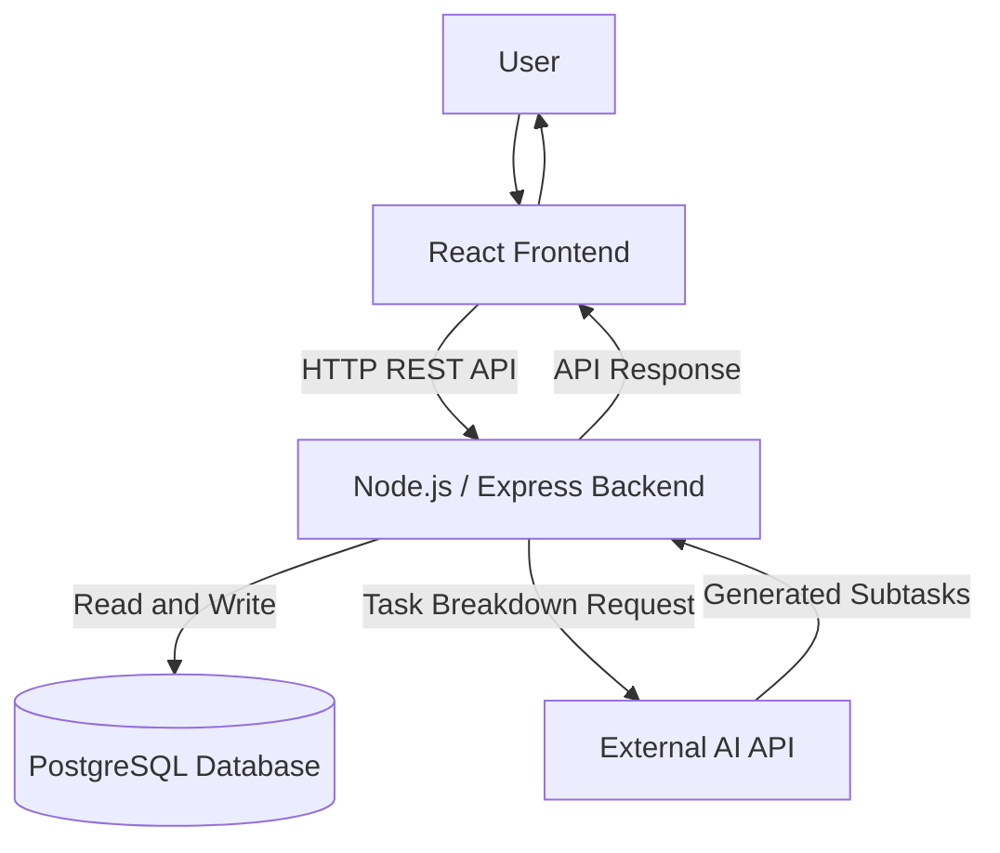

# System Architecture – TaskMaster

## 1. Overview

TaskMaster follows a simple client-server architecture. The frontend communicates with the backend through REST APIs. The backend manages tasks, communicates with the AI service, and stores application data in PostgreSQL.

## 2. Main Components

### Frontend
- Technology: React and Tailwind CSS.
- Displays the dashboard, task list, task forms, and AI assistant interface.
- Sends HTTP requests to the backend.
- Provides a responsive interface for desktop and mobile devices.

### Backend
- Technology: Node.js and Express.js.
- Provides REST API endpoints.
- Handles task creation, updating, deletion, searching, and filtering.
- Communicates with the AI service.
- Validates incoming requests and manages database operations.

### Database
- Technology: PostgreSQL.
- Stores tasks, subtasks, and AI interaction records.
- Maintains relationships between tasks and their subtasks.

### AI Service
- An external AI API.
- Receives complex task descriptions.
- Generates smaller subtasks.
- Returns suggestions to the backend.

## 3. System Diagram

## 4. Main Workflow

1. The user interacts with the React frontend.
2. The frontend sends a request to the backend.
3. The backend validates and processes the request.
4. For normal task operations, the backend communicates with PostgreSQL.
5. For AI task breakdown, the backend sends the task description to the AI service.
6. The AI service returns suggested subtasks.
7. The backend saves the required data and returns the result to the frontend.

## 5. Deployment

- Frontend: Vercel.
- Backend: Render or Railway.
- Database: PostgreSQL hosted on a cloud database platform.
- AI integration: External AI API.

## 6. Security and Validation

- Validate user input on the backend.
- Keep AI API keys in environment variables.
- Use error handling for failed API and database requests.
- Do not expose secret credentials in frontend code.