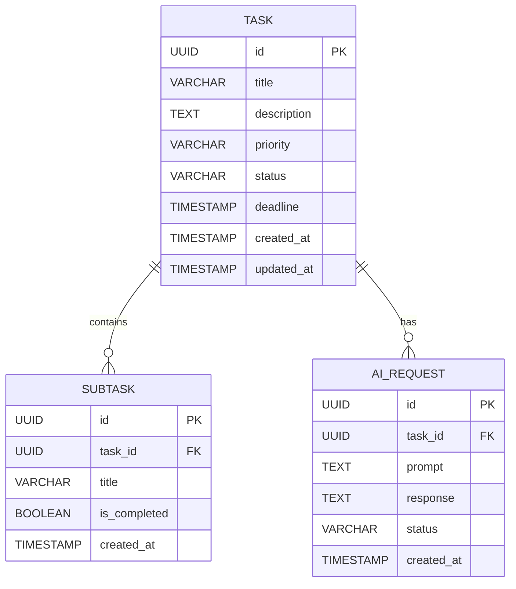

# Data Model – TaskMaster

## 1. Overview

TaskMaster uses a relational database (PostgreSQL) with three main entities: Task, Subtask, and AIRequest.

## 2. Entities

### Entity 1 – Task

Stores the main tasks created by users.

| Field | Data Type | Description |
|---|---|---|
| id | UUID | Primary key |
| title | VARCHAR(255) | Task title |
| description | TEXT | Task description |
| priority | VARCHAR(20) | Low, Medium, or High |
| status | VARCHAR(20) | To Do, In Progress, or Completed |
| deadline | TIMESTAMP | Task deadline |
| created_at | TIMESTAMP | Creation date |
| updated_at | TIMESTAMP | Last update date |

### Entity 2 – Subtask

Stores smaller tasks related to a main task.

| Field | Data Type | Description |
|---|---|---|
| id | UUID | Primary key |
| task_id | UUID | Foreign key referencing Task |
| title | VARCHAR(255) | Subtask title |
| is_completed | BOOLEAN | Completion status |
| created_at | TIMESTAMP | Creation date |

### Entity 3 – AIRequest

Stores AI task breakdown requests and their responses.

| Field | Data Type | Description |
|---|---|---|
| id | UUID | Primary key |
| task_id | UUID | Foreign key referencing Task, nullable |
| prompt | TEXT | User's AI request |
| response | TEXT | AI-generated response |
| status | VARCHAR(20) | Pending, Completed, or Failed |
| created_at | TIMESTAMP | Request creation date |

## 3. Relationships

- One Task can have multiple Subtasks (One-to-Many).
- One Task can have multiple AIRequests (One-to-Many).
- Each Subtask belongs to one Task.
- Each AIRequest can optionally be associated with one Task.

## 4. Database Constraints

- Every entity has a unique UUID primary key.
- Subtask.task_id references Task.id.
- AIRequest.task_id references Task.id and can be NULL.
- Task title is required.
- Priority must be Low, Medium, or High.
- Task status must be To Do, In Progress, or Completed.
- Subtask completion status defaults to false.

## 5. Entity Relationship Diagram

